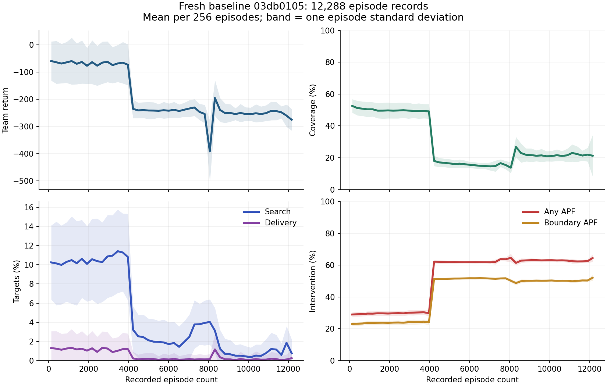

# Tiếp tục điều tra MASAC mắc góc — 12/10/2026

Đây là báo cáo giữa phiên. Các lỗi implementation đã được sửa và kiểm thử, nhưng **chưa xác nhận policy sau train 20k đã hết collapse**. Năm phiên GPU và năm CPU watcher đang chạy; checkpoint 10.098 episodes đã được kiểm tra riêng.

Repository: [truongdaoanhduy/uav_search_network](https://github.com/truongdaoanhduy/uav_search_network), branch `fix/reward-safety-investigation`.
Mã nguồn của các phiên train: [7e9b202](https://github.com/truongdaoanhduy/uav_search_network/commit/7e9b2020a86aaa2e500838c2ce8a8038c9e9685d).
Bản bàn giao mới nhất của người dùng là nguồn đối chiếu; các trạng thái cũ đã được kiểm tra lại.

## Kết luận hiện có

Nguyên nhân trực tiếp đã quan sát là actor đưa ra lệnh có hướng lệch mạnh, gần bão hòa và tương tự giữa các UAV, kể cả trước khi APF xử lý. Trên checkpoint mới 10.098 episodes, cả 6 UAV đều ra lệnh x/y dương và z âm từ cùng trạng thái khởi đầu. APF can thiệp, nhưng policy chưa học được hành vi tìm kiếm/xác nhận/giao báo cáo tốt.

Không đủ bằng chứng để quy toàn bộ nguyên nhân cho APF hoặc kết luận chỉ cần tăng hệ số reward. Tắt APF trong phép thử chuyển động của checkpoint cũ vẫn làm UAV đi vào góc và clipping. Reward APF đã phạt thật. Phép thử CPU mới cũng cho reward cao hơn khi sửa hướng độ cao trong 24 bước đầu, nên reward không hoàn toàn bỏ qua lợi ích của bay lên.

Các lỗi temperature, replay, DDP metrics, mask và handoff/checkpoint có regression tests. Dữ liệu fresh baseline vẫn suy giảm: các sửa này chưa chứng minh đã giải quyết vấn đề học dài hạn.

## Những bước đã kiểm tra lại

1. Đối chiếu HEAD local/GitHub, cấu hình thực tế trong W&B và source của từng CPU watcher, thay vì dùng trạng thái trong bàn giao làm kết quả kiểm tra.
2. Đọc learner metrics từ history. Repository chủ động đặt summary=`none` cho train/episode metrics; summary trống không chứng minh mất log.
3. Kiểm tra file checkpoint trong `run.files()`. Periodic checkpoints được upload dạng file; artifact cuối chỉ có khi hoàn tất. Artifact list trống khi đang train không phải lỗi mất checkpoint.
4. Đọc toàn bộ episode history đang có tại lúc quét, tránh lấy sampled history rồi gọi là toàn bộ. Episode rows không có `global_step`; thêm khóa này vào `scan_history(keys=...)` sẽ lọc hết các row đó.
5. Tải checkpoint mới, đối chiếu kích thước/MD5/SHA, kiểm tra actor và gradient critic trên CPU, sau đó chạy hai prefix thật với UavNetSim.
6. Giữ nguyên năm phiên train/watcher. Phiên CPU diagnostic riêng được ghi rõ là periodic, không cập nhật final summary của GPU.

## Trạng thái live

Lần kiểm tra: **01:22:33 ngày 12/10/2026, UTC+7**. Đây là snapshot, tiến độ tiếp tục thay đổi.

| Cấu hình | W&B run | Transitions | Episodes | GPU / CPU watcher |
|---|---|---:|---:|---|
| A: B256 / U16 / I1 | [03db0105](https://wandb.ai/truongdaoanhduy-uit/uav_search_target/runs/03db0105) | 25.231.360 | 16.218 | running / running |
| B: B512 / U16 / I2 | [0b67697e](https://wandb.ai/truongdaoanhduy-uit/uav_search_target/runs/0b67697e) | 5.656.576 | 702 | running / running |
| C: B512 / U32 / I4 | [1e9c0833](https://wandb.ai/truongdaoanhduy-uit/uav_search_target/runs/1e9c0833) | 5.320.704 | 678 | running / running |
| D: B512 / U64 / I8 | [f1fa4c42](https://wandb.ai/truongdaoanhduy-uit/uav_search_target/runs/f1fa4c42) | 4.419.584 | 0 | running / running |
| E: B512 / U128 / I16 | [8e541a5e](https://wandb.ai/truongdaoanhduy-uit/uav_search_target/runs/8e541a5e) | 3.145.728 | 0 | running / running |

B là global batch size; U là effective optimizer updates mỗi vector step; I = B × U / 4096. A có configured gradient_steps=1 nhưng autoscaling thành U16. Các trường còn lại của resolved config khớp nhau.

Bốn phiên B512 cho phép so sánh cường độ cập nhật ở cùng batch. So A với B512 đồng thời thay cả batch và cường độ; không gọi đó là ablation thuần cường độ. Các phiên có tiến độ khác nhau; chưa xếp hạng chất lượng. Zero completed episodes ở giai đoạn đầu không phải kết luận failure.

Mọi phiên dùng 4096 env, 2 GPU, replay/warmup 409.600, CPU replay float32, seed44, target20k. Kịch bản giữ nguyên map3000, 6 UAV, 50 targets, 30 obstacles, horizon3000, pin277200 J/UAV. Tất cả CPU watcher: GPU disabled, source GPU ref đúng, commit7e9b202, W&B online.

## Baseline fresh đang suy giảm về mission

Đã quét **12.288 episode records** hiện diện lúc bắt đầu audit, 00:41:03 ngày 12/10 UTC+7. So sánh 256 episode records đầu và cuối:

| Metric trung bình | Đầu | Cuối |
|---|---:|---:|
| Return | -58,781 | -274,693 |
| Coverage | 52,576% | 21,245% |
| Target search/confirmation | 10,250% | 0,766% |
| Target delivery | 1,305% | 0,250% |
| Target encounter | 49,648% | 20,211% |
| APF intervention | 28,966% | 64,488% |
| Boundary APF intervention | 22,928% | 52,060% |
| Coverage redundancy | 96,462% | 98,800% |
| Reward APF intervention | -75,328 | -198,198 |
| Information gain | 9.864,28 bits | 6.228,77 bits |

Đây là xu hướng trong một run, không phải so sánh cùng tiến độ giữa configs hoặc khoảng tin cậy nhiều seed. Nhóm episode đầu thuộc cohort đầu của vector environments; không diễn giải sự khác biệt như thí nghiệm nhân quả đã kiểm soát. Các episode cuối đều cạn pin trung bình, confirmation và delivery rất thấp.

Biểu đồ dùng mean mỗi 256 records, trục x là số episode records thực sự đã đọc. Dải màu là ±1 độ lệch chuẩn giữa episodes, không phải CI giữa các seeds.

Learner snapshot trước đó tại 23:38:15 ngày 11/10 UTC+7: critic loss 0,0216 ở transition22.323.200, alpha_discrete0,065, alpha_continuous0,000680, motion saturation73,19%, actor gradient norm0,00876. Loss nhỏ có thể cùng tồn tại với policy kém. Số learner này và bảng live được lấy ở các thời điểm khác nhau; không gọi là cùng điểm cuối.

## Checkpoint mới và các probe CPU

Nguồn: W&B A, file `masac_episode_00010098.pt`, 59.422.939 bytes, training transitions17.047.552, episode_index10.098.

- MD5 base64: `c4j2ePqGNo2zvV8panCfHw==`.
- SHA-256: `0f05a3f0fc1cda76ec5012ae95b5ec7f6f0d9e423079e89b35d690a72d90c737`.
- Load CPU, checkpoint_kind=`ddp_model_optimizer`, resume_safe=false; không dùng để resume train.
- Evaluation reset seed10044, resolved scenario đúng bản train.

Trước bước môi trường/APF đầu tiên, deterministic motion của cả 6 UAV khoảng x=0,567–0,585, y=0,651–0,667, z=-0,438–-0,453; norm0,984–0,985. Power action khoảng -0,97. Không có report ở trạng thái này nên destination mask chỉ có silent; silent ở đây là hành động hợp lệ duy nhất.

Gradient từ critic đến continuous action tồn tại và hữu hạn. Không tìm thấy detach làm mất đường gradient ở probe này. Critic Q là ước lượng học được; các Q đối chứng không được dùng như return thật.

### Đối chứng 24 bước với UavNetSim thật

Hai case reset cùng seed10044, giữ reward, APF, map/targets/obstacles và checkpoint. Case `actor` dùng đúng deterministic actor. Case `mirror_up` chỉ thay z bằng |z| sau khi actor chọn action; các thành phần còn lại vẫn do actor chọn theo observation của từng nhánh.

| Metric sau 24 bước | Actor | Đổi dấu z để bay lên |
|---|---:|---:|
| Return của prefix | -3,0081 | 0,3734 |
| Coverage | 0,1111% | 3,1389% |
| Information gain | 1,5025 bits | 530,9629 bits |
| UAV altitude cuối | 4,33–7,10 m | 137,89–140,69 m |
| Targets từng vào FOV | 0 | 2 |
| APF intervention | 47,22% | 40,28% |
| Search / delivery | 0% / 0% | 0% / 0% |
| Episode hoàn tất | không | không |

Kết quả giúp phân biệt lệnh actor sai với giả thuyết renderer hoặc reward không phản ứng. Bay lên mở footprint quan sát và nhận reward cao hơn trong prefix này. **Không dùng đổi dấu z làm bản sửa policy**: đây là can thiệp chẩn đoán, chưa đạt confirmation/delivery và chưa kiểm tra horizon đầy đủ. Không coi 24-step return là ground-truth Q dài hạn.

Phiên cloud đánh giá full episode + video cho cùng checkpoint:
[CPU periodic audit](https://www.kaggle.com/code/bduy2378/uav-masac-baseline-10098-cpu-audit-20261012).
Nó còn running lúc kiểm tra. Chưa có completion manifest/video để kết luận rollout đầy đủ. Không tính status running hoặc lệnh tải logs trả exit0 nhưng không có file là pass.

## Cập nhật để tránh kết luận từ checkpoint cũ hơn

Lần đọc history mới: 01:18–01:19 ngày 12/10 UTC+7. 256 baseline episode records gần nhất, episodes15.940–16.195: return trung bình -287,671; coverage16,162%; search2,828%; delivery0,102%; APF64,375%; boundary APF49,501%. Search đã tăng so với nhóm cuối của audit12.288 records, nhưng coverage/delivery vẫn thấp và can thiệp APF còn cao. Không gọi các snapshot này là cùng mốc cuối.

Learner baseline tại transition24.903.680: critic loss0,01097, alpha_continuous0,000574, alpha_discrete0,1143, actor gradient norm0,01422, saturation80,94%. Motion mean đã chuyển thành x=-0,602, y=-0,280, z=+0,640. Policy không luôn ra lệnh xuống nền trong suốt run; hướng lệch thay đổi theo quá trình học.

Checkpoint mới nhất đã upload lúc kiểm tra: `masac_episode_00015106.pt`, 59.422.939 bytes, transitions23.584.768, episode_index15.106.
MD5 base64 `whXdxNMr0L+VNtv8+mixPg==`; SHA-256 `5b3b5a8ba0c2cf252653395019bacbe2e1832486d63b7c86cad5dd4d188f8766`. Đã tải, xác nhận digest và load trên CPU.

Trạng thái khởi đầu seed10044, trước APF: cả 6 UAV đều có x/y âm, z dương; motion norm0,988–0,991. Gradient critic→action vẫn tồn tại và hữu hạn.

Chạy đúng actor này thêm24 bước trên CPU UavNetSim, không sửa action:

| Metric prefix checkpoint15.106 | Giá trị |
|---|---:|
| Return | -7,0069 |
| Coverage | 1,5208% |
| Information gain | 404,944 bits |
| APF / boundary APF | 64,58% / 63,89% |
| Action saturation | 100% |
| Targets từng vào FOV | 0 |
| Search / delivery | 0% / 0% |
| Altitude cuối | 142,04–143,87 m |
| Khoảng cách cuối tới biên y=0 | 0,84–35,51 m |
| Episode hoàn tất | không |

5/6 UAV đã ở cách biên y=0 dưới8 m sau prefix24 bước. Đây là quan sát hành vi bám biên sớm, chưa phải bằng chứng toàn bộ episode bị kẹt hoặc không thể thoát. Nó cho thấy chỉ ép z lên không giải quyết được lệch hướng ngang; không dùng probe để sửa production.

B512/U16 và U32 đã có các episode đầu với search/delivery khác0, nhưng mới ở cohort đầu. Không lấy những kết quả sớm đó để tuyên bố thắng baseline hoặc hội tụ thành công.

## Các sửa đã có và giới hạn của chúng

Các sửa trong commit7e9b202 gồm skip discrete-temperature optimizer khi toàn batch/global DDP không có choice, tổng hợp entropy metrics DDP, temporal replay/warmup guard/default, host CPU replay float32, checkpoint/config migration và khôi phục W&B sau project bị xóa, sửa source/destination namespace, completed-report masks và kiểm tra smoke checkpoint thực sự được tạo.

Suite của mã nguồn đã chạy trước production: **252 passed**, UavNetSim integration enabled; compileall/diff check đã qua. Two-T4 smoke đã có64 optimizer updates và giữ precision float32 qua GPU→CPU→GPU. Đây là kiểm chứng implementation/runtime; không chứng minh học mission.

Lịch sử `0b62f069`, `806d03ea` và CPU media của chúng đã khôi phục vào project mới. Đó là dữ liệu lịch sử còn cứu được, có nhãn partial history; không phải train mới và không thể tái tạo các records đã mất. Xem báo cáo [corner-collapse-audit-2026-10-11.md](corner-collapse-audit-2026-10-11.md).

## Phần còn phải hoàn tất

1. Đợi periodic CPU audit hoàn tất; kiểm tra manifest/hash, trace, PNG/MP4 thật, APF/altitude/corner trapping và mission metrics.
2. Đợi từng run20k và CPU watcher hoàn tất. Đối chiếu final checkpoint đúng source run, SHA, evaluation seed10044, CPU-only execution và media mới.
3. So sánh B512 cases ở cùng tiến độ và cùng evaluation scenario; báo thêm chi phí/throughput. Một seed không đủ cho kết luận tổng quát.
4. Nếu policy cuối vẫn collapse, tiếp tục phân biệt reward signal, replay coverage, entropy/exploration, critic action ranking và APF feedback bằng đối chứng có kiểm soát; chỉ sửa lỗi đã có bằng chứng. Không đổi reward/APF/algorithm tùy ý giữa các phiên hiện tại.
5. Chỉ công bố hết mắc góc khi rollout mới có hành vi và mission metrics chứng minh; pass tests, finite loss hoặc trạng thái complete của job không đủ.

Hai lịch theo dõi hiện có đã bổ sung các yêu cầu này. Bản bằng chứng máy đọc được: [corner-followup-evidence-2026-10-12.json](corner-followup-evidence-2026-10-12.json).
