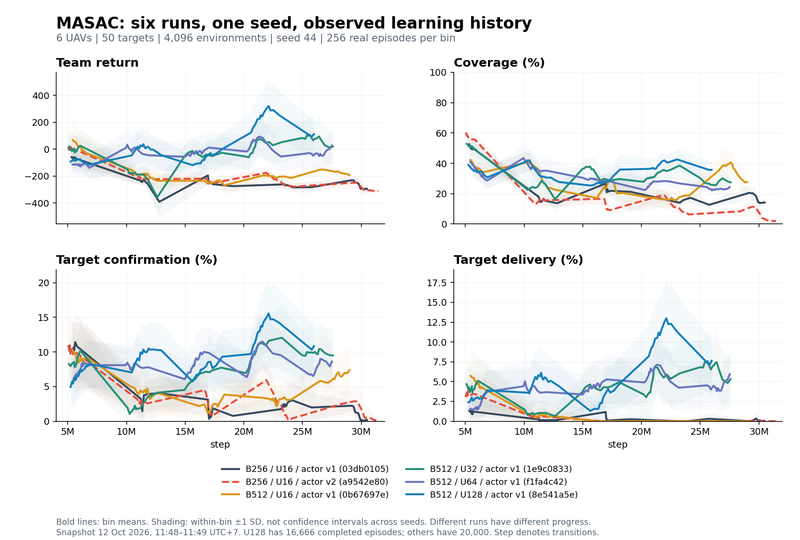

# Kiểm tra sáu MASAC run và sửa effective-action entropy

Ngày: 12-10-2026. Repo: `/home/aduy/Documents/NCKH/uav_search_target`, branch `fix/reward-safety-investigation`; base commit `7a5b0318beb7c228f9b457f2ca723fdc0da8541e`.

## Kết quả từ W&B

Đã scan toàn bộ history của sáu run, giữ đúng các bản ghi episode có giá trị hữu hạn. Snapshot metadata lấy lúc 11:48–11:49 UTC+7. Bảng so sánh trung bình 256 episode đầu với 256 episode cuối thực sự đã hoàn tất trong mỗi run. Đây là hai cohort training khác nhau; không phải evaluation các checkpoint trên cùng cảnh, và không phải confidence interval qua nhiều seed.

| Run | Batch/updates/actor | Episode đã đọc | Return đầu → cuối | Coverage % | Search/confirmation % | Delivery % |
|---|---|---:|---:|---:|---:|---:|
| [03db0105](https://wandb.ai/truongdaoanhduy-uit/uav_search_target/runs/03db0105) | 256/16/v1 | 20,000 | -58.78 → -293.40 | 52.58 → 14.34 | 10.25 → 0.21 | 1.30 → 0.06 |
| [a9542e80](https://wandb.ai/truongdaoanhduy-uit/uav_search_target/runs/a9542e80) | 256/16/v2 | 20,000 | -0.31 → -310.05 | 60.28 → 2.01 | 10.65 → 0.10 | 3.01 → 0.00 |
| [0b67697e](https://wandb.ai/truongdaoanhduy-uit/uav_search_target/runs/0b67697e) | 512/16/v1 | 20,000 | 68.38 → -185.04 | 42.21 → 27.49 | 10.23 → 7.19 | 5.73 → 0.00 |
| [1e9c0833](https://wandb.ai/truongdaoanhduy-uit/uav_search_target/runs/1e9c0833) | 512/32/v1 | 20,000 | 19.54 → 9.93 | 52.86 → 27.88 | 8.26 → 9.45 | 4.67 → 4.90 |
| [f1fa4c42](https://wandb.ai/truongdaoanhduy-uit/uav_search_target/runs/f1fa4c42) | 512/64/v1 | 20,000 | -114.01 → 9.52 | 41.00 → 23.37 | 5.61 → 7.91 | 1.57 → 5.41 |
| [8e541a5e](https://wandb.ai/truongdaoanhduy-uit/uav_search_target/runs/8e541a5e) | 512/128/v1 | 16,666 | -91.89 → 99.68 | 38.89 → 35.58 | 4.95 → 10.52 | 2.38 → 7.29 |

B là global batch; updates là effective optimizer updates sau mỗi vector step. Hai B256 run suy giảm rõ, kể cả actor v2. B512/U16 mất delivery. U32 có kết quả hỗn hợp: coverage giảm, delivery gần như giữ nguyên. U64 và U128 tăng return và delivery. Vì vậy không thể kết luận rằng cả sáu run đều càng train càng tệ, hoặc rằng chỉ tăng updates sẽ giải quyết toàn bộ nhiệm vụ. U128 mới có 16.666 episode tại snapshot; các run còn lại có 20.000. Không xếp hạng các configs như một thí nghiệm cùng tiến độ.

Đường đậm là mean từng bin gồm 256 episode; dải màu là ±1 sample standard deviation giữa episode, giới hạn trong [0,100] đối với tỷ lệ phần trăm. Bin cuối có thể ít hơn 256 bản ghi. Đây không phải CI giữa seed. Trục step là global_step, tính bằng số joint transitions; khi bản ghi episode không chứa global_step, lấy vector-step value được log gần nhất phía trước.

### Dấu hiệu suy giảm cụ thể

- `03db0105`: APF intervention trung bình tăng từ 28,97% lên 65,68%; action saturation tại learner cuối là 98,13%, alpha_continuous khoảng 0,000406.
- `a9542e80`: APF tăng từ 29,86% lên 67,26%; coverage giảm từ 60,28% xuống 2,01%; learner cuối có saturation 76,13%, alpha_continuous khoảng 0,000451.
- Reward safety/APF, coverage, confirmation và delivery được kiểm tra cùng return. Critic loss là độ khớp Bellman target trên replay, không phải chỉ số hoàn thành mission.
- Actor v2 đã sửa tầng hidden cuối trong công việc trước; dữ liệu mới cho thấy sửa kiến trúc đó chưa đủ để giải quyết suy giảm.

Vòng hành vi quan sát phù hợp với actor thường chọn lệnh bão hòa, APF sửa lệnh gần biên/peer, quỹ đạo lặp lại và ít mục tiêu được xác nhận/giao. Đó là mô tả quan sát, không phải chứng minh rằng APF là nguyên nhân duy nhất.

## Lỗi tái hiện được trong learner

Môi trường bỏ qua chuyển động của UAV đã cạn pin và bỏ qua công suất khi destination=silent. Learner cũ vẫn dùng các biến đó trong joint continuous entropy, critic action input và target entropy cố định −24 = −6×4.

Phép thử dùng đúng tensor environment production, chạy trên CPU: hai UAV active, bốn UAV inactive, tất cả silent. Thay motion của bốn UAV inactive và thay power của tất cả UAV:

| Phép đo trước sửa | Kết quả |
|---|---:|
| Next observation/state/reward giữa hai nhánh | Giống bit-for-bit |
| Sai khác next state lớn nhất | 0 |
| Số chiều motion có hiệu lực | 6 |
| Số chiều power có hiệu lực | 0 |
| Target entropy cũ | −24 |
| Norm input-gradient entropy của các UAV inactive | 7,29465 |

Như vậy learner nhận tín hiệu tối ưu từ các lệnh không thay đổi nhiệm vụ. Critic còn nhận các biểu diễn khác nhau cho những lệnh có cùng tác dụng. Đây là lỗi objective/representation đã được xác minh. Chưa có đối chứng training mới để khẳng định nó giải thích toàn bộ chênh lệch quality của sáu run.

## Các sửa đã thực hiện

`uav_marl/algorithms/masac.py`:

1. Chỉ tính motion entropy của UAV active.
2. Chỉ tính power entropy trên nhánh transmitting. Giữ straight-through gradient của categorical gate để lựa chọn destination vẫn nhận được gradient từ conditional power entropy.
3. Target entropy dùng số chiều điều khiển có hiệu lực của từng mẫu: −scale × Σ active × (3 + transmitting). Hai UAV active và silent có target −6; sáu UAV active và transmitting có target −24.
4. Critic canonicalizes ignored controls: motion của UAV inactive và power khi silent bằng 0; destination của UAV inactive là silent. Áp dụng cho replay actions, next-policy target actions và actor-update actions.
5. Batch không có điều khiển có hiệu lực không làm Adam của continuous alpha tiến bước hoặc thay momentum.
6. Bổ sung continuous_target_entropy, continuous_action_dimensions và continuous_entropy_error để quan sát đúng objective.

`uav_marl/training/gpu.py`:

- DDP dùng chung actor.sample với learner thường.
- Tất cả ba critic-action paths của MASAC DDP truyền observations để canonicalize.
- Eligibility và alpha gradients được tổng hợp giữa rank; các continuous entropy metrics cũng được tổng hợp toàn bộ rank.

Actor weights, raw continuous action outputs và thứ tự lấy mẫu không bị thay đổi bởi bản sửa này. Checkpoint cũ vẫn có thể được đánh giá bằng architecture version đúng; sửa learner không tự huấn luyện lại checkpoint đó. Reward, APF, kịch bản và hyperparameters vật lý giữ cấu hình của các phiên quan sát để có thể đối chứng riêng thay đổi learner.

Đây là hybrid MASAC với state-dependent effective-action entropy, không thay thế MASAC bằng heuristic điều khiển UAV.

## Kiểm chứng

- Regression mới trước sửa: 9 failed, 1 passed.
- Sau sửa: 20 focused checks passed, gồm masked entropy, critic invariance, transmitting power gradient, categorical gradient, hai-rank temperature/metrics và Adam momentum.
- Test entropy của power bão hòa cũ được chỉnh fixture để thật sự là UAV active và nhánh transmitting; vẫn giữ assertion gradient=2.0.
- Full suite có UavNetSim integration: **278 passed, 0 failed, 0 skipped**, 461,80 giây, exit code 0.
- Có review độc lập; không có Critical/Important findings. Đã bổ sung các trường hợp còn thiếu mà review nêu.
- Kiểm thử lần này chạy CPU và hai-rank Gloo. Không tính đó là CUDA/T4 runtime verification hay chứng minh cải thiện training.

## Evaluation và các giới hạn còn lại

CPU final của baseline `03db0105` đã finished: [1c8e7aaa](https://wandb.ai/truongdaoanhduy-uit/uav_search_target/runs/1c8e7aaa), seed10044, CPU UavNetSim. Return −338,94; coverage1,51%; search/delivery0%; APF66,14%; saturation89,48%; episode2049 bước, toàn bộ UAV cạn pin.

CPU final của U64 `f1fa4c42` đã finished: [0bc9f3f0](https://wandb.ai/truongdaoanhduy-uit/uav_search_target/runs/0bc9f3f0). Return −139,83; coverage13,13%; search/delivery4%/4%; APF56,59%. Đây là kết quả CPU của checkpoint cũ, không phải evaluation bản sửa mới.

Ba CPU evaluation run liên quan tới v2/U16/U32 ở trạng thái crashed, chưa có final metrics: `c0ebd0b9`, `8cf11c80`, `d054d76b`. Các run đó chỉ có requirements/metadata trong W&B files lúc kiểm tra, không có output.log để xác định exception từ W&B. Không coi những evaluation này là pass và không suy ra nguyên nhân crash từ việc thiếu metrics. U128 chưa có CPU final trong snapshot.

APF collision-violation metrics trong những evaluation cũ là số vi phạm mô hình/khoảng cách được đếm qua bước, không phải số tai nạn vật lý độc lập. Suite pass không chứng minh APF bảo đảm tránh mọi va chạm.

Replay 409.600 transitions / 4096 env = khoảng 100 vector step lịch sử, trong khi nhiều episode dài 1200–1800 bước. Mỗi env chỉ hoàn tất trung bình khoảng 4,88 episode khi tổng budget là 20.000. Đây là rủi ro về temporal coverage và phân bố replay; cần ablation giữ dữ liệu lâu hơn hoặc giảm env width. Chưa sửa tùy ý replay/algorithm dựa trên tương quan này.

Lượt training tiếp theo cần pin source mới, dùng cùng config/seed làm đối chứng, đánh giá checkpoint trên cùng evaluation seeds và kiểm tra coverage/search/delivery/APF. Fresh training kết thúc và CPU evaluation có kết quả trước khi tuyên bố lỗi suy giảm chất lượng đã được giải quyết.

## Dữ liệu và tài liệu

- Bằng chứng số: `masac-effective-action-audit-2026-10-12.json` trong cùng thư mục; gồm capture times, first/last windows, mọi bin và learner snapshots.
- Regression: `tests/test_masac_effective_actions.py`.
- [SAC objective và Bellman target, OpenAI Spinning Up](https://spinningup.openai.com/en/latest/algorithms/sac.html).
- [Replay capacity/replay ratio, Fedus et al., ICML 2020](https://proceedings.mlr.press/v119/fedus20a.html). Kết quả paper không chứng minh buffer là nguyên nhân của run này.
